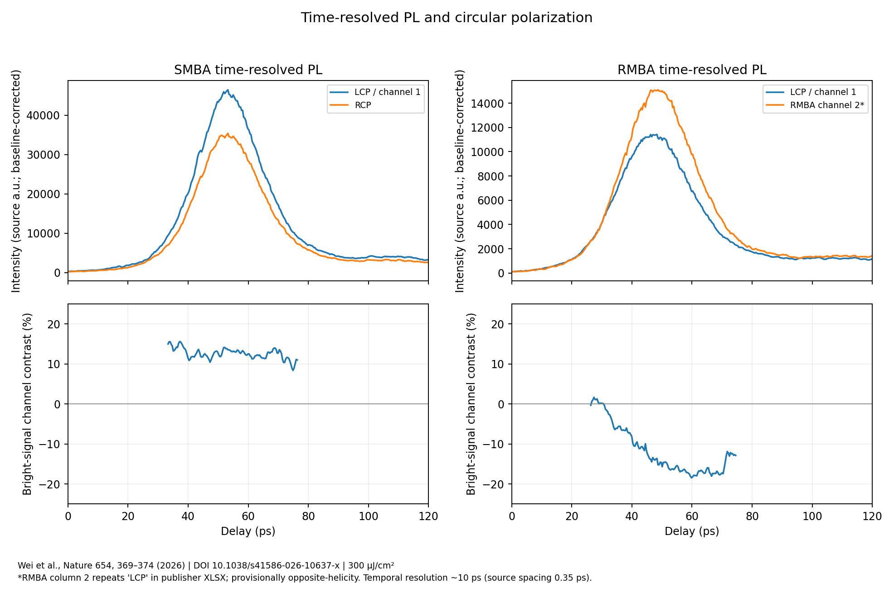
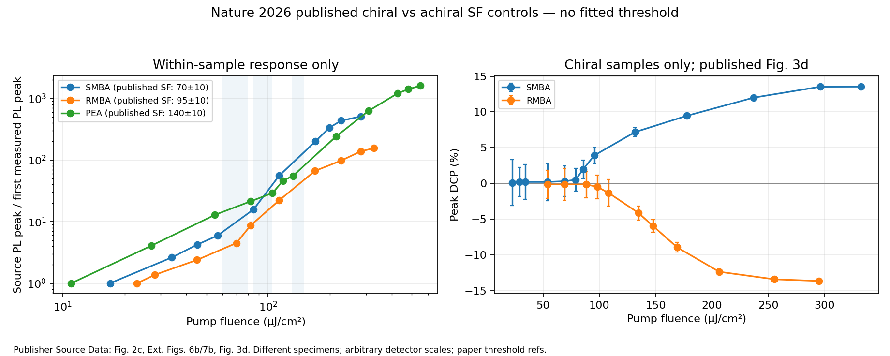

# Optical data from chiral layered perovskites

I began with the 298 K CIFs for R-, S- and racemic NEA₂PbBr₄ from Jana et al. The R/S crystals have the same space group, `P2₁`, while the racemate is `P2₁/c`. One calculated quantity looked promising at first: the Pb-to-halide-centroid displacement projected onto the crystallographic b-axis had opposite signs for R and S. I then reversed the b-axis in the same structures without moving any atoms. The displacement signs flipped too. I kept the geometric measurements but dropped that signed projection as an indicator of absolute handedness.

The next difficulty was connecting a particular structure to an optical measurement. The available crystal and thin-film data came from different specimens, so I turned to datasets with measured optical channels. Hautzinger et al.'s R/S spectra exposed a practical parsing problem: their CD, absorbance and PL columns have different wavelength axes and blank cells. Splitting on arbitrary whitespace shifted the columns; reading the file as tab-separated data fixed it. The resulting R/S CD correlation is −0.8752, compared with 0.9992 for ordinary absorption. Those observations led to the polarized-emission data examined below. The spectra and structures throughout this repository come from the cited publications.

## Time-resolved emission

Wei et al., [*Nature* **654**, 369–374 (2026)](https://doi.org/10.1038/s41586-026-10637-x), published polarization-resolved photoluminescence from superlattices made with R- or S-MBA. Source Data Fig. 3c contains 1,399 delay points for each sample, measured at a pump fluence of 300 µJ cm⁻².



Taking the left- and right-circular channels at the maximum of their summed intensity gives peak circular polarization of +13.49% for S-MBA and −13.76% for R-MBA. The corresponding values after subtracting the pre-burst background are +13.52% and −13.81%. Both agree with the published values near 300 µJ cm⁻².

Both RMBA intensity columns in the published Excel file are labeled `LCP`. Treating the second as the opposite-helicity channel gives the negative polarization plotted in Fig. 3d. I left the original headings untouched and noted the likely labeling error in the output.

The source traces are sampled approximately every 0.35 ps, although the streak-camera resolution reported in the paper is about 10 ps. I have left the analysis at the measured polarization contrast rather than fitting a relaxation time to that sampling interval.

## Pump fluence and the PEA control

The same paper contains fluence-dependent PL for S-MBA, R-MBA and the nonchiral PEA superlattice. PEA also shows superfluorescence. The paper reports circularly polarized superfluorescence for the two chiral samples.



| Sample | Superfluorescence threshold reported by Wei et al. (µJ cm⁻²) |
| --- | ---: |
| S-MBA | 70 ± 10 |
| R-MBA | 95 ± 10 |
| PEA | 140 ± 10 |

These thresholds are taken from the paper's time-integrated PL analysis. The plotted intensity curves are normalized separately, since their raw detector units are not comparable between specimens.

Another mismatch occurs in the deposited RMBA data: Extended Data Fig. 7a has a time trace labeled 85 µJ cm⁻², whereas Fig. 7b lists an intensity point at 82 µJ cm⁻². The scripts keep these records separate.

## Other measurements

The [Hautzinger et al. spin-LED dataset](https://doi.org/10.1038/s41586-024-07560-4) also includes circularly polarized electroluminescence. The light comes from an AlGaInP quantum well, not directly from the chiral perovskite. Its two deposited polarization columns have no R/S identifiers, so I kept their original names.

The [Jana et al. crystal structures](https://doi.org/10.1038/s41467-020-18485-7), the S-MBA₂PbI₄ temperature series, the S-NEA front/back CD measurements and a nonchiral transient-absorption dataset are included as separate checks. Their calculated values and source notes are collected in `results/` and `data/README.md`.

[Detailed results](docs/results.md) · [Methods](docs/methods.md) · [Original datasets](data/README.md)

## Running the analyses

Python 3.10 or later:

```bash
python -m pip install -e ".[dev,viz]"
python scripts/reproduce.py --fetch
python -m pytest -q
```

The first script downloads the original CIF and spectroscopy files and regenerates the plots and tables. When the input files are already present, `python scripts/reproduce.py` reruns the calculations without downloading them.

Source measurements stay in `data/raw/`, outside version control. `src/chiral_perovskites/` contains the analysis routines; `results/` contains the published-data comparisons. `python scripts/verify_results.py` checks the committed outputs against [their recorded hashes](results/manifest.json).

## Possible experiment

The project is paused before new experiments. The first practical question is whether I can access a PL spectrometer with a calibrated quarter-wave plate and linear polarizer in the collection path. I would start with independently prepared R- and S-MBA₂PbI₄ films, check XRD/absorption/PL, and measure both circular channels from the same spot before and after rotating each sample. Only a repeatable handedness-dependent signal would justify requesting polarization-resolved TRPL. I have not confirmed access to the required optics or prepared these samples.

[Experimental notes](docs/experimental-follow-up.md) · [License](LICENSE) · [Citation](CITATION.cff)
