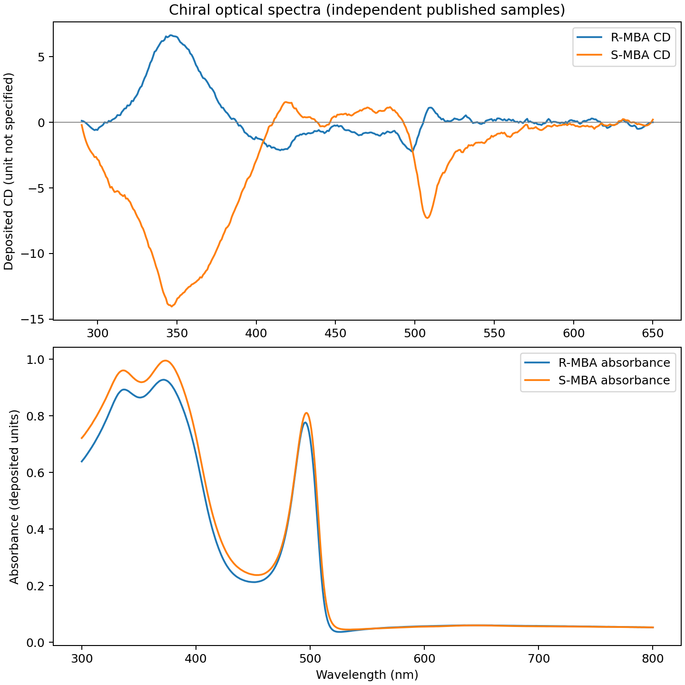

# Chirality and polarization in layered halide perovskites

Organic chiral cations can alter the symmetry of layered halide perovskites and the polarization of their optical response. This repository examines published crystal structures, circular dichroism, polarized emission and time-resolved measurements to distinguish structural chirality from the optical and device signals associated with it.

The work uses experimental datasets from several studies. The central analysis concerns R/S and achiral perovskite superlattices; single-crystal geometry and chiral spin-LED measurements provide separate comparisons. Results are reproductions and data checks of published experiments, with no new physical mechanism claimed.

## Circularly polarized superfluorescence

Wei et al., [*Nature* 654 (2026) 369–374](https://doi.org/10.1038/s41586-026-10637-x), measured polarization-resolved emission from quasi-two-dimensional perovskite superlattices containing R- or S-MBA spacers. Their Fig. 3 source data include paired emission channels over 1,399 delays and a separate fluence-dependent polarization series.


The degree of circular polarization at the peak of the total emission is +13.49% for the S-MBA sample and −13.76% for R-MBA, calculated directly from the deposited time traces. Subtracting the mean pre-burst background changes these to +13.52% and −13.81%. These values agree with the paper's Fig. 3d measurements near 300 µJ cm⁻².

The corresponding fluence data provide an achiral PEA control. Superfluorescence occurs in all three superlattices, while the reported circularly polarized superfluorescence is specific to the chiral samples.


The authors report the following superfluorescence thresholds from time-integrated photoluminescence:

| Superlattice | Published threshold (µJ cm⁻²) |
| --- | ---: |
| S-MBA | 70 ± 10 |
| R-MBA | 95 ± 10 |
| PEA (achiral) | 140 ± 10 |

The left panel compares each source intensity series relative to its own first measurement. The measured intensities are in arbitrary units and have not been calibrated for comparison across different samples. The right panel shows the deposited R/S peak-polarization data and reported errors.

[Polarized-emission analysis](docs/methods.md) · [Numerical results](docs/results.md) · [Fig. 3 audit](results/nature2026_sf_fig3c_audit.json) · [Fluence source audit](results/nature2026_fluence_control_audit.json)

## Optical and structural comparisons

Hautzinger et al., [*Nature* 631 (2024) 307–312](https://doi.org/10.1038/s41586-024-07560-4), published R/S-MBA perovskite absorption and CD spectra together with circularly polarized electroluminescence from spin-LEDs employing AlGaInP quantum wells.



Across the deposited wavelengths, the R/S absorption spectra have a Pearson correlation of 0.9992; the CD spectra give −0.8752. The two device-polarization series have opposite signs at six reported current settings. The source file does not identify the handedness of each device-polarization column, so the analysis retains the original channel labels. The quantum-well emission is considered separately from intrinsic perovskite photoluminescence.

Jana et al., [*Nature Communications* 11 (2020) 4699](https://doi.org/10.1038/s41467-020-18485-7), deposited R-, S- and racemic NEA₂PbBr₄ crystal structures at 298 K. The R/S structures are assigned to `P2₁`; the racemic structure is `P2₁/c`. The project also contains a 100–298 K series for S-MBA₂PbI₄. Local octahedral geometry is reported alongside symmetry, without using a crystallographic axis-dependent displacement sign as an absolute handedness label.

[Experimental structures](results/nea_matched_298K.csv) · [Structural methods](docs/methods.md)

## Reproducibility

Requires Python 3.10 or later. Raw CIF and spectroscopy files are downloaded from their original repositories and are excluded from Git; source identifiers and checksums are stored with the derived results.

```bash
python -m pip install -e ".[dev,viz]"

# Download source files and regenerate analyses
python scripts/reproduce.py --fetch

# Run the unit tests and verify recorded output fingerprints
python -m pytest -q
python scripts/verify_results.py
```

To regenerate results without downloading, run `python scripts/reproduce.py` after obtaining the original input files. The individual analysis modules are listed in [Methods](docs/methods.md).

The repository contains Python analysis code in `src/chiral_perovskites/`, tests in `tests/`, selected figures and tables in `results/`, and the corresponding source inventory in [data/README.md](data/README.md). The [results manifest](results/manifest.json) records hashes for the committed outputs.

## Experimental follow-up

The open data establish reproducible comparisons of published observations. Testing how handedness affects polarization retention would require matched R/S/achiral samples, independent fabrication batches, polarization-resolved time traces, and instrument-response and orientation controls. These measurements are not part of the current repository.

[Experimental considerations](docs/experimental-follow-up.md) · [Data sources](data/README.md) · [License](LICENSE) · [Citation](CITATION.cff)
